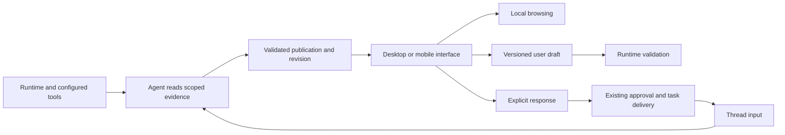

# Agent-driven interfaces in Studio

Investigation and implementation, 16 November 2026.

## Recommendation

Make agent-created interfaces useful places to work inside a thread. A user should be able to
inspect data, compare options, edit a plan and return a clear decision. Browsing an interface should
not start another model turn. Returning a decision should preserve the thread's existing action and
permission rules.

Keep Studio's existing runtime, MCP Apps host and A2UI protocol. Expand the Dovo component catalog
and improve its update lifecycle. Use MCP Apps for interfaces that need tool access. Use artifacts
for custom documents. Do not introduce a second application runtime or a second state transport.

The wider opportunity is a common interaction model across investigation, planning, review,
operations and setup. A2UI is one way to render that interaction. Adding more components alone does
not supply trusted data, live queries, action permissions or durable workflows.

## What Studio already has

| Path                       | Best use                                                                | Existing boundary                                                         |
| -------------------------- | ----------------------------------------------------------------------- | ------------------------------------------------------------------------- |
| Native questions and forms | A short decision that blocks agent work                                 | Existing question identity, choices and reply delivery                    |
| Dovo A2UI                  | Agent-composed tables, comparisons, guided input and bounded dashboards | Validated catalog, saved drafts and approved thread responses             |
| MCP Apps                   | A tool server's interactive application                                 | Sandboxed UI, runtime-owned tool session, scoped calls and host approvals |
| Artifacts                  | A custom document, visualization or offline application                 | Saved versions and isolated bundled content                               |
| Native Studio screens      | Stable product workflows with domain actions                            | Typed product APIs, accounts, computers and native platform behavior      |

These are distinct contracts. A generic table should not replace the native PR screen. A native PR
screen can open a focused agent-created comparison when that helps the user. A custom artifact
should not acquire runtime credentials because it looks like an application.

The current A2UI code already had revision checks, draft conflicts, compatible-update preservation,
action receipts, permission rechecks and restart persistence. Its catalog contained ten basic
components. It lacked rich comparison views, local workspace navigation and automatic handling of
agent-published revisions in an open card.

## Protocol findings

I inspected the installed A2UI core and React adapter at `0.15.0`, Studio's protocol and host code,
and these upstream project documents:

- [A2UI](https://github.com/google/A2UI/blob/main/README.md) defines UI as data and separates
  inference, transport and rendering. Its native rendering model does not require a WebView. Studio
  currently uses its React renderer inside the existing MCP Apps WebView on mobile.
- [MCP Apps](https://github.com/modelcontextprotocol/ext-apps/blob/main/README.md) defines
  interactive tool applications with UI resources and host communication. Studio already has this
  host, including resource policy, app tools, exports and lifecycle handling.
- [AG-UI](https://github.com/ag-ui-protocol/ag-ui/blob/main/README.md) defines agent events and
  shared-state communication. It is useful at an external agent integration boundary. It is not a
  replacement for a component catalog, authorization or Studio's persisted task state.
- [json-render](https://github.com/vercel-labs/json-render/blob/main/README.md) provides constrained
  catalogs, local state, visibility rules and cross-platform adapters. Its local interaction model
  is useful design evidence. Adding its runtime now would require maintaining another renderer,
  expression system, state model and migration path beside the installed A2UI implementation.

These documents establish the projects' designs. They do not verify their performance, current
interoperability or suitability for every Studio provider. No new framework dependency was added.

## A common interaction model

An interface needs four kinds of state with different owners:

| State                | Owner                             | Examples                                              |
| -------------------- | --------------------------------- | ----------------------------------------------------- |
| Observed domain data | Runtime or configured tool source | PR head, command result, issue ID, selected computer  |
| Agent interpretation | Agent publication                 | A proposed explanation, risk estimate or plan         |
| User input           | Saved card draft                  | Selected rows, instructions, numeric limits           |
| View state           | Open renderer                     | Active tab, table filter, sort order, expanded detail |

Keep those owners visible in the design. An agent-written metric is not proof that a check ran. Show
command evidence through a runtime-backed workflow when verification matters. Label sample and
proposed data. Never let a generated "passed" label become a release gate.



This diagram describes the combined interaction. It does not imply that A2UI has a direct live query
engine. Its data comes from agent publications and runtime reads of the saved card. MCP Apps remains
the existing route for tool-connected interfaces.

### Identity and recovery

Use the existing runtime, thread, card key, publication revision and draft version. Reusing a stable
key updates one workspace. A new key creates another workspace. The runtime rejects a stale agent
publication and a stale client draft instead of replacing newer work.

An incoming agent update must not replace a local draft that is invalid, unsaved or awaiting an
acknowledgement. Keep the current input visible and offer an explicit load-and-replace choice.
Uncertain response delivery must remain visible. Do not retry a potentially completed action as a
new action. The current response receipt mechanism prevents duplicate sends for the same request
identity; it does not establish exactly-once delivery across arbitrary external systems.

Tab selection, sort order and search text are local view state in this implementation. They do not
start a model turn or request approval. They reset when the card is reopened or its processor is
replaced. Selected rows and configured inputs use durable draft bindings and survive compatible
agent updates.

### Actions

Keep actions specific to their purpose:

1. Local exploration changes only the current view. Tabs, filtering, sorting and disclosure remain
   available after a response and in view-only use.
2. Input edits save only the card's declared bindings. They do not change the source repository,
   account, runtime configuration or external system.
3. A card button requests approval to send the runtime-resolved event and values to the thread. The
   client cannot replace the action definition. The message grants no extra permission.
4. Tool-connected reads and writes use the existing MCP Apps or native Studio paths. Retain their
   scope, credentials, confirmation and recovery behavior.

Do not add a generic "execute" action to the catalog. A code block is displayed text. A proposed
command is not a command result. Choosing a computer in a generated interface is not permission to
start work on that computer.

## Implemented toolkit

The catalog now has twenty components. Existing definitions remain valid.

| Need      | Components and behavior                                                     |
| --------- | --------------------------------------------------------------------------- |
| Summarize | `Metric`, `Badge`, `Callout` and `Progress`                                 |
| Compare   | `DataTable` with numeric sorting, local filtering and bound row selection   |
| Explain   | `CodeBlock` and `BarChart`, rendered without agent-supplied executable code |
| Organize  | `Tabs` with keyboard navigation and `Disclosure`                            |
| Configure | `NumberField`, plus the existing text, choice and checkbox inputs           |
| Compose   | Existing rows, columns, lists, cards, dividers and response buttons         |

Number inputs enforce finite values, limits and steps at the runtime. An empty numeric draft is
allowed while editing. Required fields are checked before requesting approval. A temporarily
out-of-range edit stays visible locally and is saved when corrected. Table selections must contain
unique IDs from the declared rows. An agent update that removes a selected row fails rather than
silently erasing that choice.

The runtime also validates resolved display bindings. Sharing a path between an input and a display
component cannot turn a string label into an object or an invalid progress value.

Open cards listen for the existing host's tool-list change notification and read the latest saved
revision. This uses notifications, not a polling loop. Compatible confirmed drafts remain intact.
Local input wins over automatic replacement when a save or revision conflicts.

The [change review workbench](../examples/a2ui/change-review-workbench.json) is a complete tool
publication. It combines an overview, file comparison, configuration, saved selections and an
approved response. Its data is explicitly illustrative. It does not run tests, inspect a real PR or
create a review session.

## Where to go further

The next useful product step is a real, runtime-backed investigation workspace. Start with one
workflow, such as choosing review findings to verify. Use actual review IDs and pinned head
revisions. Let the user inspect evidence and submit a bounded verification plan through the existing
review service. Keep the agent's interpretation separate from command output.

Before adding a generic live-data system, prove these requirements in that workflow:

- Bind reads to a specific runtime, project, account and domain object. Reject a stale PR head.
- Define which fields are observed facts and which are agent proposals.
- Reuse the native operation's permission and receipt behavior for each action.
- Preserve drafts when the source changes, and explain choices that are no longer valid.
- Verify reconnects, cancellation and two-device conflicts at the real API boundary.

Several larger capabilities remain deliberate follow-up work:

- Runtime-backed domain components for diffs, command evidence and source navigation.
- Bounded live subscriptions with visible source, freshness and stop behavior.
- Conditional workflows and repeated data templates. The current catalog still uses static child
  references and has no agent-supplied expression evaluator.
- A native React Native renderer. Mobile currently uses the shared web renderer.
- Reusable cross-thread workspaces, workflow publication and shared editing. A2UI currently belongs
  to one thread and its runtime.
- Broad localization, native accessibility audits and physical-device verification of the expanded
  toolkit. The renderer's own control text remains English.
- An AG-UI adapter when an actual external integration requires it. Do not add a second event bus in
  anticipation of that integration.

## Verification

Run from the repository root:

```sh
pnpm --filter @dovo/a2ui typecheck
pnpm --filter @dovo/protocol typecheck
pnpm exec vp test packages/protocol/src/a2ui.test.ts packages/runtime/src/mcp-apps/a2ui.test.ts packages/runtime/src/agent-tools/interactions.test.ts packages/runtime/src/agent-tools/context-budget.test.ts packages/runtime/src/agent-tools/server.test.ts --maxWorkers=4
pnpm exec playwright install chromium
pnpm test:a2ui:browser
pnpm test:mcp-apps:browser
```

The A2UI browser suite uses the bundled renderer, real nested MCP Apps frames and a local runtime's
paired-client HTTP API. It covers both host modes, local exploration, keyboard tabs, table
selection, numeric validation, restored drafts, live agent revisions, unsaved-input preservation,
approval and duplicate-response protection. Agent delivery uses a fixture sink. It does not verify
live model behavior or physical iOS and Android WebViews. Browser screenshots are written to
`work/a2ui-workbench/`.
