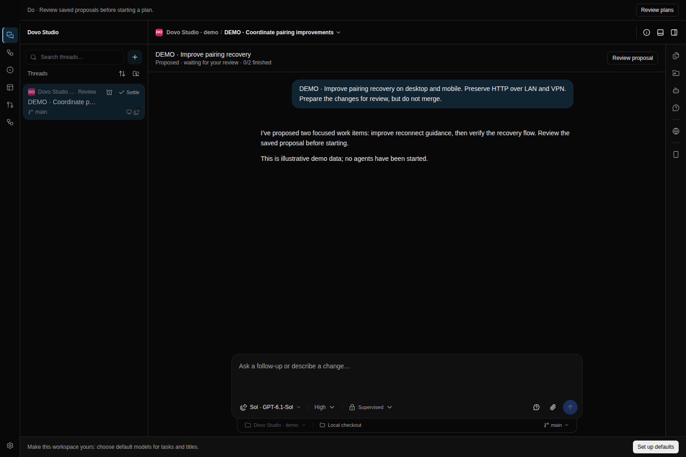
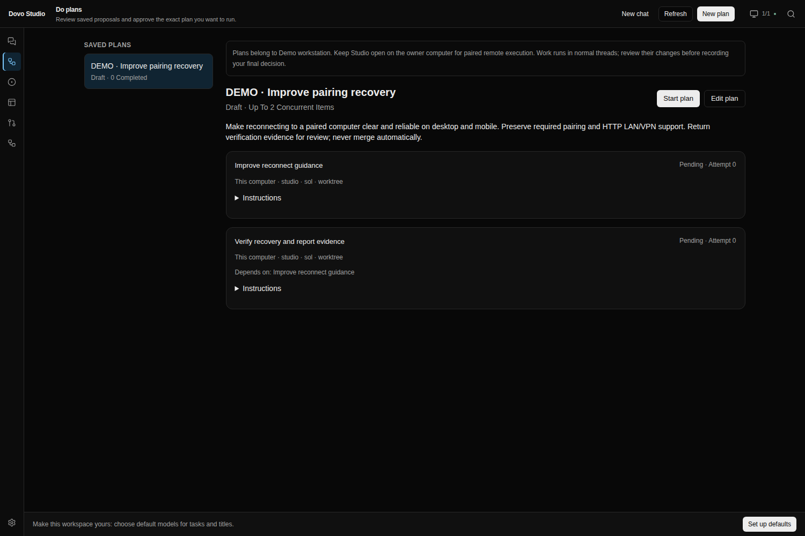

# Do (experimental)

Do starts with a goal in a normal agent conversation. Describe what you want to achieve; a
configured agent can ask questions, discover available projects and computers, and propose a
concrete plan. You review the saved work items, assignments and dependencies before explicitly
starting execution. An explicit plan editor is also available under **Review plans**.

## Enable it per computer

Do is off by default. On desktop/web, open **Settings → Running tasks** on the computer that will
own the plan and enable **Do (experimental)**. On mobile, open that computer's preferences under
**Devices & runtime** and enable **Enable experimental Do**. The preference is `enableDo`; the
runtime snapshot exposes it as `doEnabled`.

Turning Do off pauses new dispatch; it does not cancel agent threads that already started. Cancel
the run before disabling Do if you need its work to stop.

Enable Do on every destination computer used by a work item, too. Projects, configured agents and
their providers must already be usable there. Do keeps the usual pairing codes, paired-device tokens
and agent approval rules. It does not require an account or a separate Do credential. HTTP runtime
addresses remain supported over LAN and VPN; HTTPS is optional.

Open **Do** in desktop/web navigation, or **Do (experimental)** from mobile Settings or Tasks.
Choose the plan's home computer on mobile. Plans and execution state belong to that runtime, not to
the phone or browser.

## Describe a goal and review the proposal

Start from the goal composer in **Do**. Sending the goal opens a normal task conversation with the
configured planning agent. Continue talking there to clarify scope and constraints. The agent can
discover available targets and save a proposed plan; it cannot approve or start that plan for you.

Project context and agent are optional. Desktop offers these controls in the composer; mobile puts
them in **Chat options**. With no project selected, the conversation uses the No project workspace;
with no agent selected, it uses the project's default agent. These choices set the conversation's
context, while the proposal can target other projects and paired computers.

Choose **Review proposal** on the conversation's proposal card, or open **Review plans** from Do.
Inspect the instructions, projects, agents, computers, dependencies and concurrency before choosing
**Start plan**. Saving a proposal does not dispatch its work items. The planning conversation uses
the agent's normal tools and permissions, so state any limits on changes or external actions in your
goal. Work-item execution still requires the separate human start gate.

Planning quality depends on the configured agent and provider. The scope is bounded work proposed in
conversation and started by a human.

## Use the explicit editor

Open **Review plans** to inspect saved proposals, follow runs, or author a plan directly:

1. Choose **New plan**, enter a title and goal, then add work items with concrete instructions and
   verification expectations.
2. For each item, choose its computer, project, optional configured agent and checkout. An omitted
   agent uses the project's default. A new worktree isolates changes; a shared project checkout
   needs care when several items edit the same files.
3. Set dependencies on items that must finish first, and the maximum concurrent items. A plan
   supports up to 32 items and 1–8 concurrent items (default 2). Dependencies must reference known
   items and cannot contain cycles.
4. **Save plan** persists an editable draft. Saving does not dispatch agents. Review the saved
   instructions and assignments, then choose **Start plan**. Mobile asks for a separate start
   confirmation. Unsaved desktop changes must be saved first.

Saving and starting use the saved plan revision. If another client changes the draft, reload and
review it before trying again; a stale write cannot silently replace it. After starting, the plan is
fixed. To change the instructions or assignments, create a new plan.

Dependencies gate an item's start until its dependencies complete. They supply bounded,
agent-reported summaries, thread references and recorded branch names to downstream instructions.
They do not copy uncommitted files, commit or push branches, merge changes, or synchronize worktrees
and computers. A recorded branch name alone may not include the earlier item's uncommitted edits.

When an item needs earlier code in another checkout or on another computer, explicitly arrange
accessible files or commits in the item instructions. The agent must inspect what is available and
ask for missing code or access before proceeding; dependency completion does not make that code
available automatically. The initial version has no automatic code synchronization layer.

## Follow execution and respond

The home runtime persists the plan, dispatches ready work within its concurrency limit and observes
each item's normal task thread. Keep that runtime running. Local execution does not depend on
leaving a phone or browser open.

The destination runtime serializes Do work that shares a project's main checkout, including work
from separate plans or paired origins. A competing item stays blocked until the checkout is free.
Use worktrees for parallel edits. This does not lock files against unrelated manually started tasks.

For plans proposed in a Do conversation, the runtime sends state-change notices back into that
conversation when work needs attention, waits for human input, finishes or is cancelled. The agent
can explain the next step there. Answer an item's question or approval in that item's thread;
review, retry and start controls remain in **Review plans**.

Notices are durably queued and deduplicated, with the runtime checking for changes every five
seconds. They follow normal task-queue rules: an explicit queue pause stays paused, and queued
notices survive a restart and follow normal recovery. Resume the queue when you want the agent to
respond. A chat automatically settled by housekeeping reopens for a notice; explicitly settled or
archived chats remain closed.

For work on paired computers, **keep Studio open and connected on the home computer**. Studio
registers its paired-computer connections with the home runtime; a headless runtime alone does not
discover those connections. Keep each target runtime reachable and Do enabled there. Closing the
phone does not stop work, but losing the registered remote connection can prevent dispatch,
observation or stop confirmation. These connections are not persistent runtime-to-runtime bridges.

| Run state                      | What to do                                                                        |
| ------------------------------ | --------------------------------------------------------------------------------- |
| Draft / Saved draft            | Edit, save and explicitly start the reviewed plan.                                |
| Running                        | Follow the work-item states and open their threads.                               |
| Attention / Needs attention    | Inspect failed or blocked items; restore the target or retry unfinished work.     |
| Cancelling / Stopping work     | Wait for owned threads to confirm stopping; reconnect remote computers if needed. |
| Cancelled                      | Confirmed stops are recorded. Inspect changes before retrying.                    |
| Review / Ready for your review | Inspect every thread, its changes and verification, then record a decision.       |
| Completed / Reviewed           | A human accepted or rejected the results; the decision is recorded.               |

Items distinguish pending, dispatching, running, waiting for a human, blocked, completed, failed,
cancelling and cancelled. A question, approval or paused queue remains in its normal thread; choose
**Open thread** or **Respond in thread** to answer. Do does not answer approvals for you. Blocked
items show a reason, such as an unavailable computer, disabled Do, or missing project or agent. The
runtime reconciles blocked dispatches when their cause clears.

Result cards show an excerpt of the final agent message and the runtime-recorded branch when
available. The summary is agent-reported and unverified; a finished thread is not proof that its
tests passed or that the goal was achieved. Open the thread and inspect the actual changes.

## Retry, cancel and review

**Retry** targets failed, blocked or cancelled items and preserves completed work. Failed or
cancelled items continue with a follow-up in their original thread and checkout where available; the
runtime recreates a thread only if the original no longer exists. A blocked dispatch is reconciled
using its existing attempt identity to avoid duplicate delivery. Retry never rolls back files or
guarantees that an interrupted command had no external effect.

**Cancel run** requests stops only for threads owned by that run and prevents work that has not
started from starting. Files, completed results and threads are kept. A run stays **Cancelling**
while any owned stop is unconfirmed. An offline remote computer can leave a stop unconfirmed;
reconnect it and follow the reported reason. Do does not label potentially active remote work as
cancelled. Stopping confirmation continues even when new Do dispatch is disabled.

When all items complete, the run waits for **final human review**. Inspect each thread and its
changes, then accept or reject the results with an optional note. Both decisions finish the run and
record your review. This action does not merge, push or publish anything. Normal agent tools and
permissions still apply during execution; give explicit limits in each work item's instructions when
external actions must be excluded.

## API and verification

Paired clients use JSON `POST /api/do/{list,read,discover,save,start,retry,cancel,complete,delete}`.
Chat entry uses `POST /api/do/chat/create` with a client-generated request UUID, text, and optional
project and agent IDs. It returns a normal `taskId`; further conversation uses the usual task APIs.
Retrying unchanged input with the same request UUID returns the same task without sending the first
message twice. Reusing that UUID with changed input is a conflict.

`POST /api/do/chat/plans` takes a `taskId` and returns that conversation's saved proposals for its
in-conversation cards; **Review proposal** opens the exact saved plan, and **View work** opens a
run.

These client endpoints require a paired-device token; agent run tokens are rejected. The
coordinator's `do_plan` tool uses the separate agent-authenticated `POST /api/do/agent` endpoint,
scoped to its active Do chat turn. It can discover targets, propose drafts, list/read its own
proposals and cancel its own runs. It cannot start, retry, complete or delete them. The contracts
live in [the plan protocol](../packages/protocol/src/runtime/do.ts),
[the chat protocol](../packages/protocol/src/runtime/do-chat.ts) and
[the proposal-card protocol](../packages/protocol/src/runtime/do-chat-plans.ts). Runtime-owned item
state and results are read-only to clients. Draft saves and starts use `expectedRevision`. Deleting
a draft or finished run keeps its work threads; the initial UI focuses on creation, execution and
review rather than exposing every API operation.

Run the component browser verification with:

```sh
pnpm exec playwright install chromium
pnpm test:do:browser
```

The suite mounts the production desktop Do view and mobile React Native screens/composer/editor in
the repository browser harness, with schema-validated simulated API data and native host adapters.
It exercises default chat entry, optional context, failure recovery, request-ID reuse after a lost
reply, task navigation and stale-owner/focus guards. Existing lifecycle coverage runs through the
secondary **Review plans** entry: saved drafts, human starts, conflicts, dependencies, waiting for
input, retry, unconfirmed cancellation, final review and offline guards. Runtime scheduler and
persistence behavior have separate runtime tests. These schema-controlled browser fixtures do not
invoke a live LLM or prove the quality of an agent-generated plan.

The primary screenshots show the compiled production desktop workbench against an isolated real
runtime:

| Conversation with its proposal card                                                         | Exact saved proposal opened for human review                                                    |
| ------------------------------------------------------------------------------------------- | ----------------------------------------------------------------------------------------------- |
|  |  |

These captures use illustrative demo messages and a manually saved plan. HTTP responses and UI
controls are unmocked: the production conversation card loads its owned proposal through
`/api/do/chat/plans`, and **Review proposal** opens that exact saved run. The capture script
verifies navigation, absence of page errors, and that the plan remains an unstarted draft. No
providers or agents were started; the assistant message is seeded demo content, not live LLM output.
The captures do not verify planning quality or agent execution. The reproducible capture is
[capture-do-workbench.mjs](../scripts/capture-do-workbench.mjs), using the built desktop and
runtime.

The earlier [full workbench draft capture](screenshots/do/desktop-workbench-draft.png) is retained
as a record of the explicit editor before the chat-first entry update.

The six component screenshots below use visibly labelled simulated data. Desktop component captures
are 1440×1000 browser renders of the implemented Do view. Mobile captures are 390×844 **React Native
component renders in Chromium**, not native-device screenshots. Native layout, menus, gestures and
device execution were not verified by this suite.

Desktop component captures use the production controls, compiled product stylesheet, default Dovo
palette and application font stack. They omit the full workbench chrome. Mobile renders use the
production screens, composer, editor and settings styles, with browser adapters for native
primitives, choice menus, headers and sheets; those host controls are approximations of their device
presentation.

| State                                   | Desktop UI                                                            | Mobile components in browser                                                |
| --------------------------------------- | --------------------------------------------------------------------- | --------------------------------------------------------------------------- |
| Start a conversation                    | [Desktop chat entry](screenshots/do/desktop-chat-start.png)           | [Mobile chat entry](screenshots/do/mobile-chat-start-browser.png)           |
| Review a saved proposal before starting | [Desktop proposal review](screenshots/do/desktop-proposal-review.png) | [Mobile proposal review](screenshots/do/mobile-proposal-review-browser.png) |
| Running                                 | [Desktop running](screenshots/do/desktop-running.png)                 | [Mobile running](screenshots/do/mobile-running-browser.png)                 |

Proposal and running captures use manually seeded or editor-saved demo plans. They show the actual
review and execution components, not a plan produced by a live provider.
