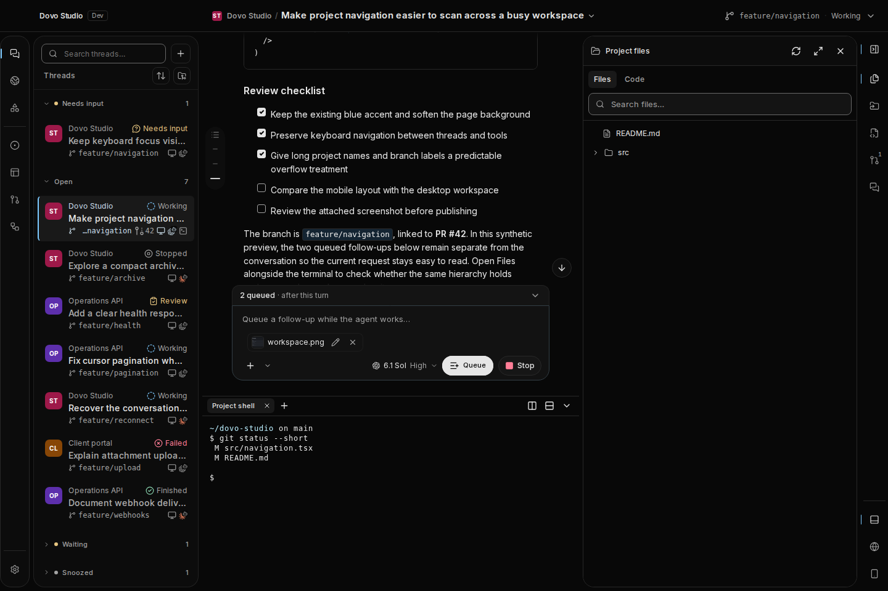
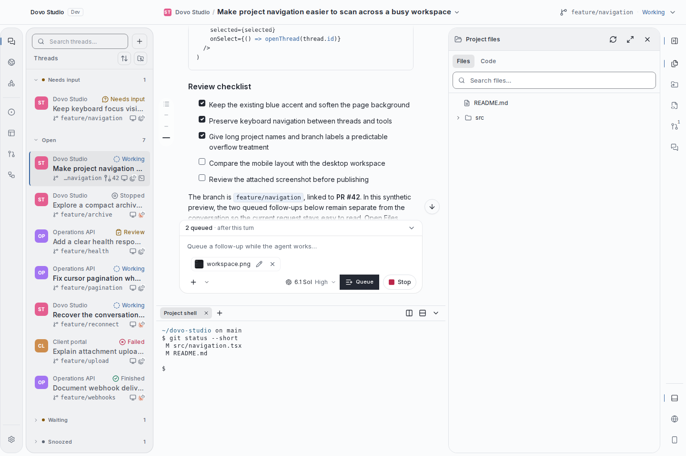
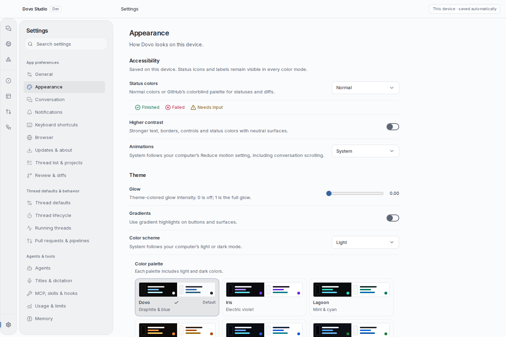
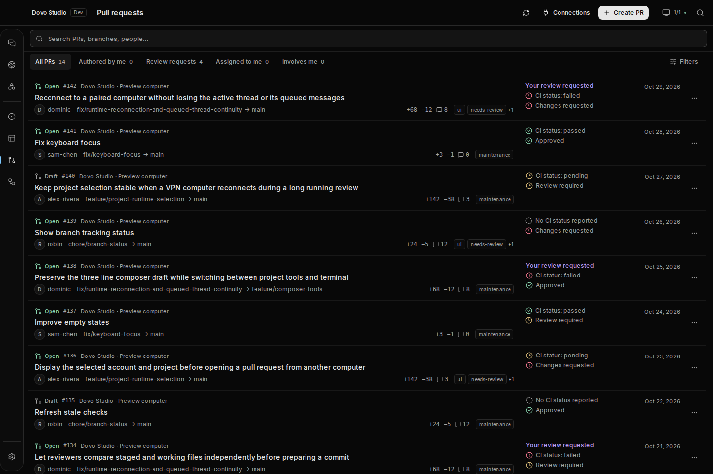
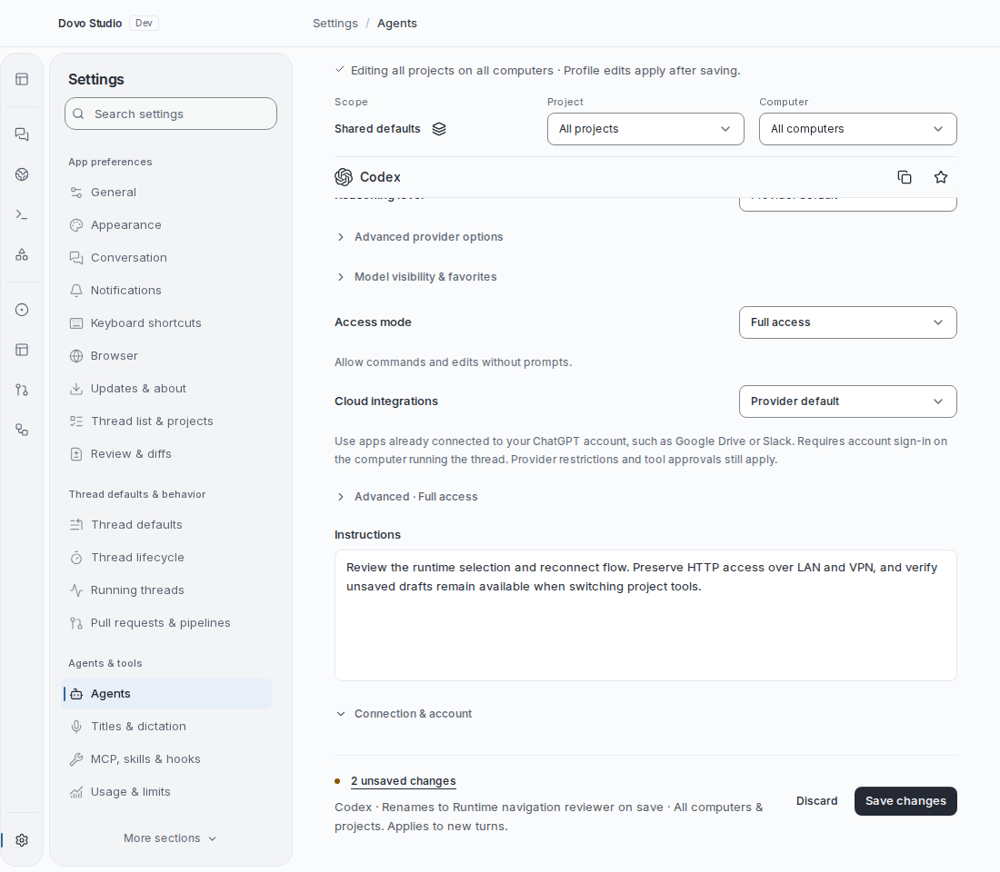

# UI polish overhaul

The desktop workspace keeps its `#080808` dark canvas, thin activity rail, rounded outlined
sidebars, and flat borderless main chat and Browser. Shared typography, gutters, selection and
control styles make the workspace and its secondary surfaces feel consistent.

## Review the result

| Unified workspace · dark                                                | Unified workspace · light                                                 |
| ----------------------------------------------------------------------- | ------------------------------------------------------------------------- |
|  |  |

| Thread info                                       | Settings · Appearance                            |
| ------------------------------------------------- | ------------------------------------------------ |
|  |  |

| PR list                                             | Agent editing                                               |
| --------------------------------------------------- | ----------------------------------------------------------- |
|  |  |

- **Workspace:** thread rows retain project/status above one-line ellipsized titles and machine,
  harness, PR and terminal indicators. Thread info overlays chat above the composer. All sections,
  grouping, ordering and visibility controls remain. Queue/composer layouts adapt to narrow panes;
  Stop, Queue and Steer are icon-only with hover titles and accessible names. Wrapped Markdown
  bullets and checklists retain hanging indents.
- **Settings:** page-specific breadcrumbs, aligned fields, consistent section hierarchy and labeled
  project/computer targets pinned during scoped editing. Controls respond to the actual content
  width; Agent profiles switch between flat master/detail and a searchable compact picker. Automatic
  and explicit saves remain clearly distinguished, including an initial save cue on scoped forms.
  Agent draft actions stay reachable in an opaque footer with readable profile and target identity.
  Instructions spans the form with six readable lines; substantial help uses full-width rows.
  Appearance retains all palettes and font previews, with a bounded terminal size stepper. Search,
  legacy notices, explicit-save groups and unsaved-navigation guards remain. Save cues and
  Editing/Viewing context follow the selected computer’s capabilities; offline targets show one
  reconnect instruction. Mixed-save pages name their explicit-save exceptions, and computer forms
  explain automatic-save timing. Save guidance has a readable text size and emphasis; offline
  defaults and lifecycle offer a direct route to Devices & runtime without changing the selected
  target. Settings search uses the visible thread labels and focuses the matching control; the
  navigation offers a measured continuation action for lower sections. Running-thread save feedback
  appears before its introduction, and lifecycle links retain the computer while opening the
  relevant restart/archive or PR settling defaults.
- **Git and PRs:** staged/unstaged groups support partial staging, selection and per-file Unstage.
  Changed-file groups share a bounded scroll area, keeping the commit form discoverable at dense
  desktop sizes; modest three/four-entry change sets fit at the captured normal and compact desktop
  widths, while its continuation cue explains overflow in dense lists. Commit controls show the
  inspected branch/checkout; readable filenames retain full-path tooltips. Per-file comparisons are
  read-only, offer Previous/Next within their comparison group, and preserve Back/draft/selection
  context. Push reflects branch tracking. PR lists reserve a responsive readiness column and keep
  the target branch visible. Issues keep stable Open/Closed filters. Merge readiness separates
  repository status, check reports and linked pipelines; the Checks view explains the repository
  provider’s separate CI summary. Failure consent is visible, accessible and invalidated by status
  changes. CI and review signals keep the same order down the PR list. Merge dialogs keep action
  buttons outside the scrolling form body, including when status-source details are expanded.
  Work-list separators remain visible alongside the shared collection-row border treatment.
- **Dialogs and images:** shared themed confirmations preserve Cancel/return focus, drafts and
  queued decisions, and reject stale runtime/caller/target decisions. MCP details scroll without
  losing consent. Project-deletion blockers provide a safe route to active work. Image
  preview/editing, annotations, crop, fit/actual-size, zoom and pan retain themed controls and
  source-image geometry.

## Evidence and limits

The gallery contains **344 actual app captures across 172 surfaces**, each in dark and light,
including 1100px compact layouts, dense lists, edited Agent forms, long Git comparisons, open
controls and follow-up/image dialogs. Checked-in WebPs are lossless conversions, verified
pixel-for-pixel against the PNGs. The latest pass recaptures every state after the final Settings
search/navigation and PR source-explanation refinements, against matching frozen source. The frozen
manifest records this provenance. Six earlier comparisons remain below.

Captures use production components with schema-checked synthetic data and blocked account/runtime
writes. Dense lists contain 14 rows; some other collections intentionally show empty states. The
native Browser bridge is simulated. Terminal uses the production worker/renderer/WASM with a local
WebSocket replay. Long Git fixture patches include full-file context. These are verification limits,
not evidence of live Electron, provider, account or terminal execution behavior.

Independent council review is **in progress**, and the design approval target has not been met.
Briefs omit past and target scores; reviewers receive frozen screenshots and matching source.
[council.json](council.json) records assessments, coverage and provider limitations. The latest
exact `muse-wonder-full-1.0` attempt failed on provider quota, with a reported reset at 2026-11-04
23:52 UTC; no assessment is claimed for that attempt. AGY lists `gemini-4-argon-high`, but its
latest direct sandboxed review returned `503 auth_not_found`; no Gemini assessment is claimed.

A [generated Settings reference](../../output/imagegen/README.md) informed hierarchy and field
alignment, responsive composition and quieter navigation. The [Opus direction](design-direction.md)
records the implementation priorities. Generated concepts are separate from the actual application
evidence.

## Verification

Checks run for the overhaul include production web UI/web/desktop builds, affected package types,
scoped lint/format/diff checks, and targeted browser verification:

- Composer actions, drafts, queue, controls, narrow layouts, Stop contrast and icon-only hover
  names.
- Settings scope/inheritance/saving/navigation, Agent forms and reachable save/error actions.
- PR lists/workspaces, stable issue filters, source targeting, merge guards, failure consent and
  drafts.
- Git staging/partial staging/Unstage/commit/Push, read-only comparisons, unknown targets and long
  paths.
- Markdown wrapped bullets, ordered/nested lists and checklists; themed dialog continuation fades.
- Shared controls, keyboard/focus, selected/disabled states, forced colors and constrained pickers.
- Async confirmations, queued/full MCP details, stale runtime/context/unmount and navigation guards.
- Appearance matrix across 34 palette/mode combinations, fonts and persistence; image and terminal
  controls.

These targeted checks do not establish every native integration or every possible control state.
Captures report no errors or preview alerts; chat and Browser dark canvas pixels measure `(8,8,8)`.

To reproduce the PNG set:

```sh
pnpm exec playwright install chromium
pnpm --filter @dovo/protocol build
pnpm --filter @dovo/web-ui build
pnpm --filter @dovo/client-runtime build
node scripts/capture-ui-polish.mjs /tmp/dovo-ui-review --all --controls --dialogs
```

Use `--only=conversation,pulls,appearance,browser,thread-info` for a focused pass.

## Full gallery

170 surfaces in both themes. Compact, controls and expanded status-source states are listed
explicitly.

| Surface                                  | Dark                                                                         | Light                                                                         |
| ---------------------------------------- | ---------------------------------------------------------------------------- | ----------------------------------------------------------------------------- |
| activity                                 | [Screenshot](screenshots/activity-dark.webp)                                 | [Screenshot](screenshots/activity-light.webp)                                 |
| add-agent                                | [Screenshot](screenshots/add-agent-dark.webp)                                | [Screenshot](screenshots/add-agent-light.webp)                                |
| add-agent-model                          | [Screenshot](screenshots/add-agent-model-dark.webp)                          | [Screenshot](screenshots/add-agent-model-light.webp)                          |
| add-agent-model-scrolled                 | [Screenshot](screenshots/add-agent-model-scrolled-dark.webp)                 | [Screenshot](screenshots/add-agent-model-scrolled-light.webp)                 |
| add-agent-profile                        | [Screenshot](screenshots/add-agent-profile-dark.webp)                        | [Screenshot](screenshots/add-agent-profile-light.webp)                        |
| add-mcp                                  | [Screenshot](screenshots/add-mcp-dark.webp)                                  | [Screenshot](screenshots/add-mcp-light.webp)                                  |
| add-skill                                | [Screenshot](screenshots/add-skill-dark.webp)                                | [Screenshot](screenshots/add-skill-light.webp)                                |
| agents                                   | [Screenshot](screenshots/agents-dark.webp)                                   | [Screenshot](screenshots/agents-light.webp)                                   |
| agents-offline                           | [Screenshot](screenshots/agents-offline-dark.webp)                           | [Screenshot](screenshots/agents-offline-light.webp)                           |
| agents-dirty-compact                     | [Screenshot](screenshots/agents-dirty-compact-dark.webp)                     | [Screenshot](screenshots/agents-dirty-compact-light.webp)                     |
| agents-dirty                             | [Screenshot](screenshots/agents-dirty-dark.webp)                             | [Screenshot](screenshots/agents-dirty-light.webp)                             |
| agents-legacy                            | [Screenshot](screenshots/agents-legacy-dark.webp)                            | [Screenshot](screenshots/agents-legacy-light.webp)                            |
| appearance-controls                      | [Screenshot](screenshots/appearance-controls-dark.webp)                      | [Screenshot](screenshots/appearance-controls-light.webp)                      |
| appearance                               | [Screenshot](screenshots/appearance-dark.webp)                               | [Screenshot](screenshots/appearance-light.webp)                               |
| appearance-palettes                      | [Screenshot](screenshots/appearance-palettes-dark.webp)                      | [Screenshot](screenshots/appearance-palettes-light.webp)                      |
| approval-rules                           | [Screenshot](screenshots/approval-rules-dark.webp)                           | [Screenshot](screenshots/approval-rules-light.webp)                           |
| archived-tasks                           | [Screenshot](screenshots/archived-tasks-dark.webp)                           | [Screenshot](screenshots/archived-tasks-light.webp)                           |
| artifact-actions                         | [Screenshot](screenshots/artifact-actions-dark.webp)                         | [Screenshot](screenshots/artifact-actions-light.webp)                         |
| artifact-export                          | [Screenshot](screenshots/artifact-export-dark.webp)                          | [Screenshot](screenshots/artifact-export-light.webp)                          |
| artifact-settings                        | [Screenshot](screenshots/artifact-settings-dark.webp)                        | [Screenshot](screenshots/artifact-settings-light.webp)                        |
| artifacts                                | [Screenshot](screenshots/artifacts-dark.webp)                                | [Screenshot](screenshots/artifacts-light.webp)                                |
| branch-menu                              | [Screenshot](screenshots/branch-menu-dark.webp)                              | [Screenshot](screenshots/branch-menu-light.webp)                              |
| branch-move                              | [Screenshot](screenshots/branch-move-dark.webp)                              | [Screenshot](screenshots/branch-move-light.webp)                              |
| browser-bookmarks                        | [Screenshot](screenshots/browser-bookmarks-dark.webp)                        | [Screenshot](screenshots/browser-bookmarks-light.webp)                        |
| browser-controls                         | [Screenshot](screenshots/browser-controls-dark.webp)                         | [Screenshot](screenshots/browser-controls-light.webp)                         |
| browser                                  | [Screenshot](screenshots/browser-dark.webp)                                  | [Screenshot](screenshots/browser-light.webp)                                  |
| browser-history                          | [Screenshot](screenshots/browser-history-dark.webp)                          | [Screenshot](screenshots/browser-history-light.webp)                          |
| browser-settings                         | [Screenshot](screenshots/browser-settings-dark.webp)                         | [Screenshot](screenshots/browser-settings-light.webp)                         |
| browsers-panel                           | [Screenshot](screenshots/browsers-panel-dark.webp)                           | [Screenshot](screenshots/browsers-panel-light.webp)                           |
| busy-conversation                        | [Screenshot](screenshots/busy-conversation-dark.webp)                        | [Screenshot](screenshots/busy-conversation-light.webp)                        |
| busy-long-draft                          | [Screenshot](screenshots/busy-long-draft-dark.webp)                          | [Screenshot](screenshots/busy-long-draft-light.webp)                          |
| busy-mid-scroll                          | [Screenshot](screenshots/busy-mid-scroll-dark.webp)                          | [Screenshot](screenshots/busy-mid-scroll-light.webp)                          |
| busy-sections                            | [Screenshot](screenshots/busy-sections-dark.webp)                            | [Screenshot](screenshots/busy-sections-light.webp)                            |
| busy-steer                               | [Screenshot](screenshots/busy-steer-dark.webp)                               | [Screenshot](screenshots/busy-steer-light.webp)                               |
| busy-unified-workspace                   | [Screenshot](screenshots/busy-unified-workspace-dark.webp)                   | [Screenshot](screenshots/busy-unified-workspace-light.webp)                   |
| command-palette                          | [Screenshot](screenshots/command-palette-dark.webp)                          | [Screenshot](screenshots/command-palette-light.webp)                          |
| commands                                 | [Screenshot](screenshots/commands-dark.webp)                                 | [Screenshot](screenshots/commands-light.webp)                                 |
| computer-use                             | [Screenshot](screenshots/computer-use-dark.webp)                             | [Screenshot](screenshots/computer-use-light.webp)                             |
| conversation-compact                     | [Screenshot](screenshots/conversation-compact-dark.webp)                     | [Screenshot](screenshots/conversation-compact-light.webp)                     |
| conversation-controls                    | [Screenshot](screenshots/conversation-controls-dark.webp)                    | [Screenshot](screenshots/conversation-controls-light.webp)                    |
| conversation                             | [Screenshot](screenshots/conversation-dark.webp)                             | [Screenshot](screenshots/conversation-light.webp)                             |
| conversation-daybreak-help               | [Screenshot](screenshots/conversation-daybreak-help-dark.webp)               | [Screenshot](screenshots/conversation-daybreak-help-light.webp)               |
| conversation-settings                    | [Screenshot](screenshots/conversation-settings-dark.webp)                    | [Screenshot](screenshots/conversation-settings-light.webp)                    |
| device-previews                          | [Screenshot](screenshots/device-previews-dark.webp)                          | [Screenshot](screenshots/device-previews-light.webp)                          |
| devices-panel                            | [Screenshot](screenshots/devices-panel-dark.webp)                            | [Screenshot](screenshots/devices-panel-light.webp)                            |
| diffs                                    | [Screenshot](screenshots/diffs-dark.webp)                                    | [Screenshot](screenshots/diffs-light.webp)                                    |
| downloads                                | [Screenshot](screenshots/downloads-dark.webp)                                | [Screenshot](screenshots/downloads-light.webp)                                |
| draft-stash                              | [Screenshot](screenshots/draft-stash-dark.webp)                              | [Screenshot](screenshots/draft-stash-light.webp)                              |
| edit-agent                               | [Screenshot](screenshots/edit-agent-dark.webp)                               | [Screenshot](screenshots/edit-agent-light.webp)                               |
| edit-agent-dirty                         | [Screenshot](screenshots/edit-agent-dirty-dark.webp)                         | [Screenshot](screenshots/edit-agent-dirty-light.webp)                         |
| files-panel                              | [Screenshot](screenshots/files-panel-dark.webp)                              | [Screenshot](screenshots/files-panel-light.webp)                              |
| forge-connections                        | [Screenshot](screenshots/forge-connections-dark.webp)                        | [Screenshot](screenshots/forge-connections-light.webp)                        |
| git-actions-commit-ready                 | [Screenshot](screenshots/git-actions-commit-ready-dark.webp)                 | [Screenshot](screenshots/git-actions-commit-ready-light.webp)                 |
| git-actions                              | [Screenshot](screenshots/git-actions-dark.webp)                              | [Screenshot](screenshots/git-actions-light.webp)                              |
| git-actions-dense-compact                | [Screenshot](screenshots/git-actions-dense-compact-dark.webp)                | [Screenshot](screenshots/git-actions-dense-compact-light.webp)                |
| git-actions-dense                        | [Screenshot](screenshots/git-actions-dense-dark.webp)                        | [Screenshot](screenshots/git-actions-dense-light.webp)                        |
| git-actions-menu                         | [Screenshot](screenshots/git-actions-menu-dark.webp)                         | [Screenshot](screenshots/git-actions-menu-light.webp)                         |
| git-actions-review-long-scrolled-compact | [Screenshot](screenshots/git-actions-review-long-scrolled-compact-dark.webp) | [Screenshot](screenshots/git-actions-review-long-scrolled-compact-light.webp) |
| git-actions-review-long-scrolled         | [Screenshot](screenshots/git-actions-review-long-scrolled-dark.webp)         | [Screenshot](screenshots/git-actions-review-long-scrolled-light.webp)         |
| git-actions-review-long-staged-compact   | [Screenshot](screenshots/git-actions-review-long-staged-compact-dark.webp)   | [Screenshot](screenshots/git-actions-review-long-staged-compact-light.webp)   |
| git-actions-review-long-staged           | [Screenshot](screenshots/git-actions-review-long-staged-dark.webp)           | [Screenshot](screenshots/git-actions-review-long-staged-light.webp)           |
| git-actions-review-long-unstaged-compact | [Screenshot](screenshots/git-actions-review-long-unstaged-compact-dark.webp) | [Screenshot](screenshots/git-actions-review-long-unstaged-compact-light.webp) |
| git-actions-review-long-unstaged         | [Screenshot](screenshots/git-actions-review-long-unstaged-dark.webp)         | [Screenshot](screenshots/git-actions-review-long-unstaged-light.webp)         |
| git-actions-review-staged                | [Screenshot](screenshots/git-actions-review-staged-dark.webp)                | [Screenshot](screenshots/git-actions-review-staged-light.webp)                |
| git-actions-review-unstaged              | [Screenshot](screenshots/git-actions-review-unstaged-dark.webp)              | [Screenshot](screenshots/git-actions-review-unstaged-light.webp)              |
| git-actions-selection                    | [Screenshot](screenshots/git-actions-selection-dark.webp)                    | [Screenshot](screenshots/git-actions-selection-light.webp)                    |
| harness                                  | [Screenshot](screenshots/harness-dark.webp)                                  | [Screenshot](screenshots/harness-light.webp)                                  |
| image-editor-annotated                   | [Screenshot](screenshots/image-editor-annotated-dark.webp)                   | [Screenshot](screenshots/image-editor-annotated-light.webp)                   |
| image-editor-crop                        | [Screenshot](screenshots/image-editor-crop-dark.webp)                        | [Screenshot](screenshots/image-editor-crop-light.webp)                        |
| image-editor                             | [Screenshot](screenshots/image-editor-dark.webp)                             | [Screenshot](screenshots/image-editor-light.webp)                             |
| image-editor-shortcuts                   | [Screenshot](screenshots/image-editor-shortcuts-dark.webp)                   | [Screenshot](screenshots/image-editor-shortcuts-light.webp)                   |
| image-editor-zoom                        | [Screenshot](screenshots/image-editor-zoom-dark.webp)                        | [Screenshot](screenshots/image-editor-zoom-light.webp)                        |
| image-preview                            | [Screenshot](screenshots/image-preview-dark.webp)                            | [Screenshot](screenshots/image-preview-light.webp)                            |
| import-codex                             | [Screenshot](screenshots/import-codex-dark.webp)                             | [Screenshot](screenshots/import-codex-light.webp)                             |
| import-pi                                | [Screenshot](screenshots/import-pi-dark.webp)                                | [Screenshot](screenshots/import-pi-light.webp)                                |
| issue-comment                            | [Screenshot](screenshots/issue-comment-dark.webp)                            | [Screenshot](screenshots/issue-comment-light.webp)                            |
| issue-create                             | [Screenshot](screenshots/issue-create-dark.webp)                             | [Screenshot](screenshots/issue-create-light.webp)                             |
| issue-edit                               | [Screenshot](screenshots/issue-edit-dark.webp)                               | [Screenshot](screenshots/issue-edit-light.webp)                               |
| issues                                   | [Screenshot](screenshots/issues-dark.webp)                                   | [Screenshot](screenshots/issues-light.webp)                                   |
| issues-dense-compact                     | [Screenshot](screenshots/issues-dense-compact-dark.webp)                     | [Screenshot](screenshots/issues-dense-compact-light.webp)                     |
| issues-dense                             | [Screenshot](screenshots/issues-dense-dark.webp)                             | [Screenshot](screenshots/issues-dense-light.webp)                             |
| jira                                     | [Screenshot](screenshots/jira-dark.webp)                                     | [Screenshot](screenshots/jira-light.webp)                                     |
| jira-sources                             | [Screenshot](screenshots/jira-sources-dark.webp)                             | [Screenshot](screenshots/jira-sources-light.webp)                             |
| jobs                                     | [Screenshot](screenshots/jobs-dark.webp)                                     | [Screenshot](screenshots/jobs-light.webp)                                     |
| licenses                                 | [Screenshot](screenshots/licenses-dark.webp)                                 | [Screenshot](screenshots/licenses-light.webp)                                 |
| link-pr                                  | [Screenshot](screenshots/link-pr-dark.webp)                                  | [Screenshot](screenshots/link-pr-light.webp)                                  |
| linked-projects-panel                    | [Screenshot](screenshots/linked-projects-panel-dark.webp)                    | [Screenshot](screenshots/linked-projects-panel-light.webp)                    |
| local-commits                            | [Screenshot](screenshots/local-commits-dark.webp)                            | [Screenshot](screenshots/local-commits-light.webp)                            |
| memory                                   | [Screenshot](screenshots/memory-dark.webp)                                   | [Screenshot](screenshots/memory-light.webp)                                   |
| navigation-tooltip                       | [Screenshot](screenshots/navigation-tooltip-dark.webp)                       | [Screenshot](screenshots/navigation-tooltip-light.webp)                       |
| new-automation                           | [Screenshot](screenshots/new-automation-dark.webp)                           | [Screenshot](screenshots/new-automation-light.webp)                           |
| new-session                              | [Screenshot](screenshots/new-session-dark.webp)                              | [Screenshot](screenshots/new-session-light.webp)                              |
| notifications                            | [Screenshot](screenshots/notifications-dark.webp)                            | [Screenshot](screenshots/notifications-light.webp)                            |
| open-in-menu                             | [Screenshot](screenshots/open-in-menu-dark.webp)                             | [Screenshot](screenshots/open-in-menu-light.webp)                             |
| pair-computer                            | [Screenshot](screenshots/pair-computer-dark.webp)                            | [Screenshot](screenshots/pair-computer-light.webp)                            |
| pipeline-run                             | [Screenshot](screenshots/pipeline-run-dark.webp)                             | [Screenshot](screenshots/pipeline-run-light.webp)                             |
| pipelines                                | [Screenshot](screenshots/pipelines-dark.webp)                                | [Screenshot](screenshots/pipelines-light.webp)                                |
| pr-add-to-thread                         | [Screenshot](screenshots/pr-add-to-thread-dark.webp)                         | [Screenshot](screenshots/pr-add-to-thread-light.webp)                         |
| pr-ask-agent                             | [Screenshot](screenshots/pr-ask-agent-dark.webp)                             | [Screenshot](screenshots/pr-ask-agent-light.webp)                             |
| pr-auto-merge                            | [Screenshot](screenshots/pr-auto-merge-dark.webp)                            | [Screenshot](screenshots/pr-auto-merge-light.webp)                            |
| pr-auto-merge-sources                    | [Screenshot](screenshots/pr-auto-merge-sources-dark.webp)                    | [Screenshot](screenshots/pr-auto-merge-sources-light.webp)                    |
| pr-close                                 | [Screenshot](screenshots/pr-close-dark.webp)                                 | [Screenshot](screenshots/pr-close-light.webp)                                 |
| pr-comment                               | [Screenshot](screenshots/pr-comment-dark.webp)                               | [Screenshot](screenshots/pr-comment-light.webp)                               |
| pr-create                                | [Screenshot](screenshots/pr-create-dark.webp)                                | [Screenshot](screenshots/pr-create-light.webp)                                |
| pr-draft                                 | [Screenshot](screenshots/pr-draft-dark.webp)                                 | [Screenshot](screenshots/pr-draft-light.webp)                                 |
| pr-edit                                  | [Screenshot](screenshots/pr-edit-dark.webp)                                  | [Screenshot](screenshots/pr-edit-light.webp)                                  |
| pr-merge                                 | [Screenshot](screenshots/pr-merge-dark.webp)                                 | [Screenshot](screenshots/pr-merge-light.webp)                                 |
| pr-merge-sources                         | [Screenshot](screenshots/pr-merge-sources-dark.webp)                         | [Screenshot](screenshots/pr-merge-sources-light.webp)                         |
| pr-review                                | [Screenshot](screenshots/pr-review-dark.webp)                                | [Screenshot](screenshots/pr-review-light.webp)                                |
| pr-reviewers                             | [Screenshot](screenshots/pr-reviewers-dark.webp)                             | [Screenshot](screenshots/pr-reviewers-light.webp)                             |
| project-actions                          | [Screenshot](screenshots/project-actions-dark.webp)                          | [Screenshot](screenshots/project-actions-light.webp)                          |
| project-actions-discard                  | [Screenshot](screenshots/project-actions-discard-dark.webp)                  | [Screenshot](screenshots/project-actions-discard-light.webp)                  |
| project-actions-menu                     | [Screenshot](screenshots/project-actions-menu-dark.webp)                     | [Screenshot](screenshots/project-actions-menu-light.webp)                     |
| project-actions-validation               | [Screenshot](screenshots/project-actions-validation-dark.webp)               | [Screenshot](screenshots/project-actions-validation-light.webp)               |
| project-delete                           | [Screenshot](screenshots/project-delete-dark.webp)                           | [Screenshot](screenshots/project-delete-light.webp)                           |
| project-instructions                     | [Screenshot](screenshots/project-instructions-dark.webp)                     | [Screenshot](screenshots/project-instructions-light.webp)                     |
| project-transfer                         | [Screenshot](screenshots/project-transfer-dark.webp)                         | [Screenshot](screenshots/project-transfer-light.webp)                         |
| pull-changes                             | [Screenshot](screenshots/pull-changes-dark.webp)                             | [Screenshot](screenshots/pull-changes-light.webp)                             |
| pull-checks                              | [Screenshot](screenshots/pull-checks-dark.webp)                              | [Screenshot](screenshots/pull-checks-light.webp)                              |
| pull-overview                            | [Screenshot](screenshots/pull-overview-dark.webp)                            | [Screenshot](screenshots/pull-overview-light.webp)                            |
| pull-request-monitoring-settings         | [Screenshot](screenshots/pull-request-monitoring-settings-dark.webp)         | [Screenshot](screenshots/pull-request-monitoring-settings-light.webp)         |
| pulls-controls                           | [Screenshot](screenshots/pulls-controls-dark.webp)                           | [Screenshot](screenshots/pulls-controls-light.webp)                           |
| pulls                                    | [Screenshot](screenshots/pulls-dark.webp)                                    | [Screenshot](screenshots/pulls-light.webp)                                    |
| pulls-dense-compact                      | [Screenshot](screenshots/pulls-dense-compact-dark.webp)                      | [Screenshot](screenshots/pulls-dense-compact-light.webp)                      |
| pulls-dense                              | [Screenshot](screenshots/pulls-dense-dark.webp)                              | [Screenshot](screenshots/pulls-dense-light.webp)                              |
| pulls-dense-row-menu                     | [Screenshot](screenshots/pulls-dense-row-menu-dark.webp)                     | [Screenshot](screenshots/pulls-dense-row-menu-light.webp)                     |
| remote-desktop                           | [Screenshot](screenshots/remote-desktop-dark.webp)                           | [Screenshot](screenshots/remote-desktop-light.webp)                           |
| remote-desktop-legacy                    | [Screenshot](screenshots/remote-desktop-legacy-dark.webp)                    | [Screenshot](screenshots/remote-desktop-legacy-light.webp)                    |
| repository-forge                         | [Screenshot](screenshots/repository-forge-dark.webp)                         | [Screenshot](screenshots/repository-forge-light.webp)                         |
| repository-github                        | [Screenshot](screenshots/repository-github-dark.webp)                        | [Screenshot](screenshots/repository-github-light.webp)                        |
| repository-local                         | [Screenshot](screenshots/repository-local-dark.webp)                         | [Screenshot](screenshots/repository-local-light.webp)                         |
| resources                                | [Screenshot](screenshots/resources-dark.webp)                                | [Screenshot](screenshots/resources-light.webp)                                |
| running-tasks                            | [Screenshot](screenshots/running-tasks-dark.webp)                            | [Screenshot](screenshots/running-tasks-light.webp)                            |
| runtime                                  | [Screenshot](screenshots/runtime-dark.webp)                                  | [Screenshot](screenshots/runtime-light.webp)                                  |
| saved-prompts                            | [Screenshot](screenshots/saved-prompts-dark.webp)                            | [Screenshot](screenshots/saved-prompts-light.webp)                            |
| section-order                            | [Screenshot](screenshots/section-order-dark.webp)                            | [Screenshot](screenshots/section-order-light.webp)                            |
| settings                                 | [Screenshot](screenshots/settings-dark.webp)                                 | [Screenshot](screenshots/settings-light.webp)                                 |
| shortcuts                                | [Screenshot](screenshots/shortcuts-dark.webp)                                | [Screenshot](screenshots/shortcuts-light.webp)                                |
| side-chats-panel                         | [Screenshot](screenshots/side-chats-panel-dark.webp)                         | [Screenshot](screenshots/side-chats-panel-light.webp)                         |
| source-control                           | [Screenshot](screenshots/source-control-dark.webp)                           | [Screenshot](screenshots/source-control-light.webp)                           |
| source-picker                            | [Screenshot](screenshots/source-picker-dark.webp)                            | [Screenshot](screenshots/source-picker-light.webp)                            |
| stop-confirm                             | [Screenshot](screenshots/stop-confirm-dark.webp)                             | [Screenshot](screenshots/stop-confirm-light.webp)                             |
| studio-tools-settings                    | [Screenshot](screenshots/studio-tools-settings-dark.webp)                    | [Screenshot](screenshots/studio-tools-settings-light.webp)                    |
| task-behavior                            | [Screenshot](screenshots/task-behavior-dark.webp)                            | [Screenshot](screenshots/task-behavior-light.webp)                            |
| task-behavior-legacy                     | [Screenshot](screenshots/task-behavior-legacy-dark.webp)                     | [Screenshot](screenshots/task-behavior-legacy-light.webp)                     |
| task-defaults                            | [Screenshot](screenshots/task-defaults-dark.webp)                            | [Screenshot](screenshots/task-defaults-light.webp)                            |
| task-defaults-offline                    | [Screenshot](screenshots/task-defaults-offline-dark.webp)                    | [Screenshot](screenshots/task-defaults-offline-light.webp)                    |
| task-list-settings                       | [Screenshot](screenshots/task-list-settings-dark.webp)                       | [Screenshot](screenshots/task-list-settings-light.webp)                       |
| task-templates                           | [Screenshot](screenshots/task-templates-dark.webp)                           | [Screenshot](screenshots/task-templates-light.webp)                           |
| terminal-close                           | [Screenshot](screenshots/terminal-close-dark.webp)                           | [Screenshot](screenshots/terminal-close-light.webp)                           |
| terminal-close-multiple                  | [Screenshot](screenshots/terminal-close-multiple-dark.webp)                  | [Screenshot](screenshots/terminal-close-multiple-light.webp)                  |
| terminal                                 | [Screenshot](screenshots/terminal-dark.webp)                                 | [Screenshot](screenshots/terminal-light.webp)                                 |
| text-generation                          | [Screenshot](screenshots/text-generation-dark.webp)                          | [Screenshot](screenshots/text-generation-light.webp)                          |
| thread-archive-confirm                   | [Screenshot](screenshots/thread-archive-confirm-dark.webp)                   | [Screenshot](screenshots/thread-archive-confirm-light.webp)                   |
| thread-context                           | [Screenshot](screenshots/thread-context-dark.webp)                           | [Screenshot](screenshots/thread-context-light.webp)                           |
| thread-delete                            | [Screenshot](screenshots/thread-delete-dark.webp)                            | [Screenshot](screenshots/thread-delete-light.webp)                            |
| thread-info-controls                     | [Screenshot](screenshots/thread-info-controls-dark.webp)                     | [Screenshot](screenshots/thread-info-controls-light.webp)                     |
| thread-info                              | [Screenshot](screenshots/thread-info-dark.webp)                              | [Screenshot](screenshots/thread-info-light.webp)                              |
| thread-rename                            | [Screenshot](screenshots/thread-rename-dark.webp)                            | [Screenshot](screenshots/thread-rename-light.webp)                            |
| thread-template                          | [Screenshot](screenshots/thread-template-dark.webp)                          | [Screenshot](screenshots/thread-template-light.webp)                          |
| tools-tooltip                            | [Screenshot](screenshots/tools-tooltip-dark.webp)                            | [Screenshot](screenshots/tools-tooltip-light.webp)                            |
| undo                                     | [Screenshot](screenshots/undo-dark.webp)                                     | [Screenshot](screenshots/undo-light.webp)                                     |
| undo-error                               | [Screenshot](screenshots/undo-error-dark.webp)                               | [Screenshot](screenshots/undo-error-light.webp)                               |
| unified-workspace                        | [Screenshot](screenshots/unified-workspace-dark.webp)                        | [Screenshot](screenshots/unified-workspace-light.webp)                        |
| updates-settings                         | [Screenshot](screenshots/updates-settings-dark.webp)                         | [Screenshot](screenshots/updates-settings-light.webp)                         |
| usage                                    | [Screenshot](screenshots/usage-dark.webp)                                    | [Screenshot](screenshots/usage-light.webp)                                    |
| website-customization                    | [Screenshot](screenshots/website-customization-dark.webp)                    | [Screenshot](screenshots/website-customization-light.webp)                    |
| welcome-compact                          | [Screenshot](screenshots/welcome-compact-dark.webp)                          | [Screenshot](screenshots/welcome-compact-light.webp)                          |
| welcome                                  | [Screenshot](screenshots/welcome-dark.webp)                                  | [Screenshot](screenshots/welcome-light.webp)                                  |
| worktrees                                | [Screenshot](screenshots/worktrees-dark.webp)                                | [Screenshot](screenshots/worktrees-light.webp)                                |

## Before

Starting captures: [welcome](screenshots/before-welcome-dark.webp),
[conversation](screenshots/before-conversation-dark.webp),
[PR list](screenshots/before-pulls-dark.webp), [settings](screenshots/before-settings-dark.webp).

Thread info before its redesign: [dark](screenshots/before-thread-info-dark.webp),
[light](screenshots/before-thread-info-light.webp).
