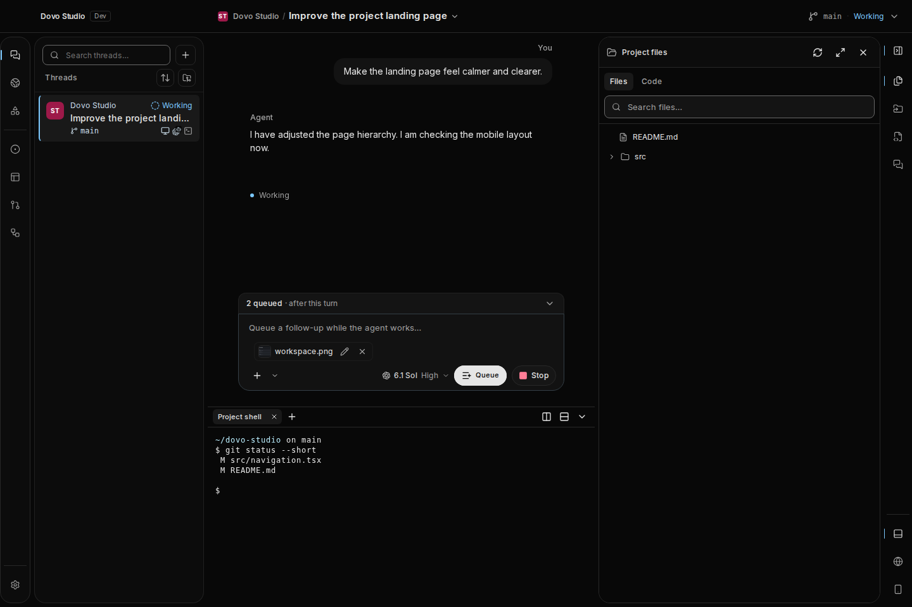
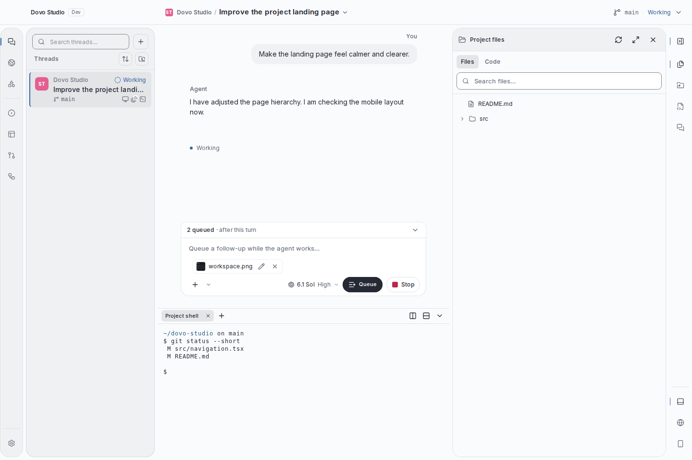
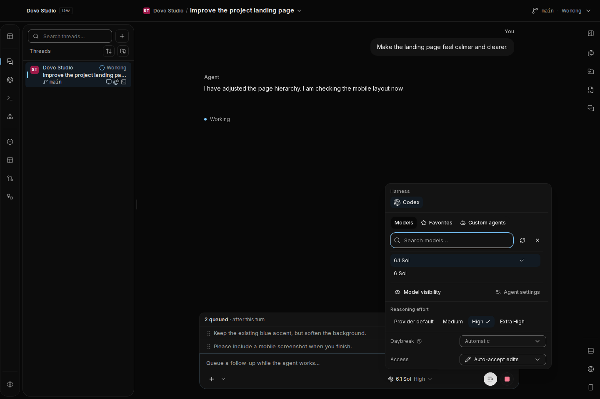
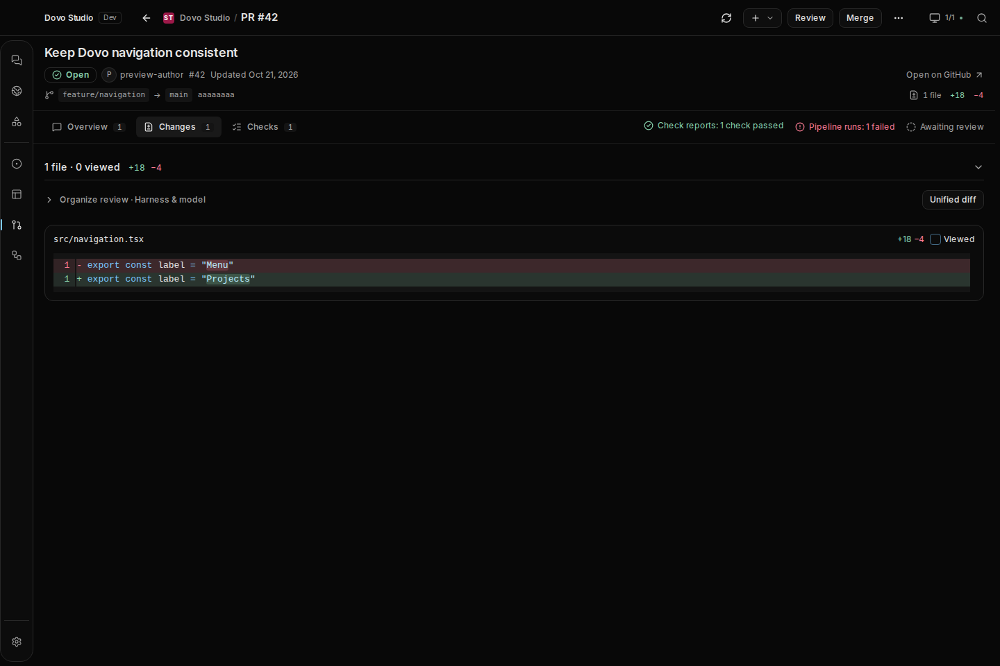
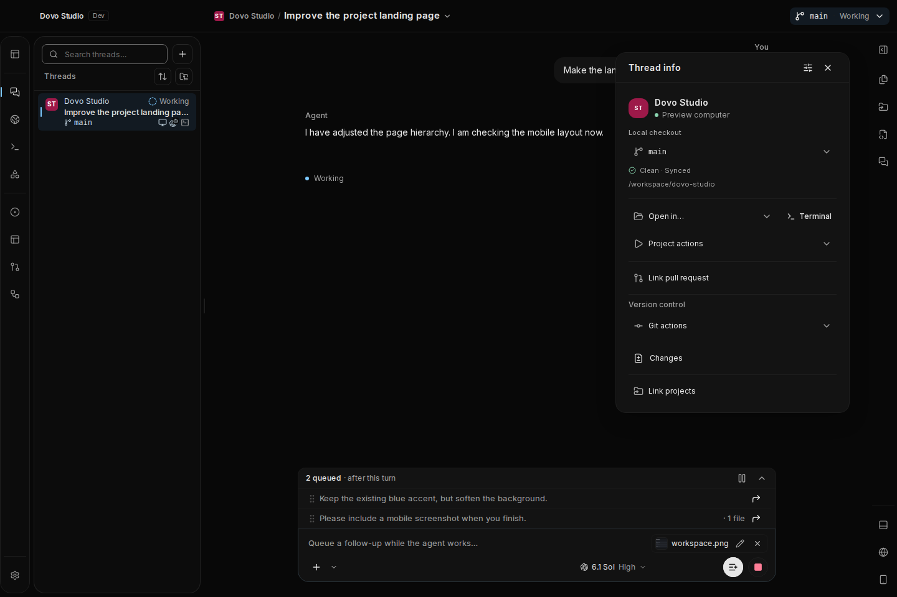
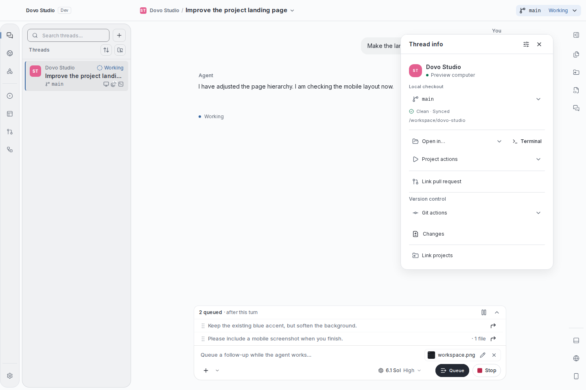

# UI polish overhaul

The desktop workspace keeps its black `#080808` canvas and thin, icon-only activity bar. Bundled
Inter, calmer surfaces, shared gutters and more readable metadata bring the conversation, Browser,
PRs, terminal, panels and settings into one visual system.

Thread info now floats over the chat without resizing the conversation, bounded to the chat pane
and clear of its composer. Flat project, checkout and action sections retain their customization order and
visibility, portal state and close/Escape controls. Sidebars retain softly outlined rounded corners; the main chat and Browser surfaces stay flat
and borderless. Neutral selections and restrained separators keep the composition calm.

## Review the result

| Unified workspace · dark                                           | Unified workspace · light                                            |
| ------------------------------------------------------------------ | -------------------------------------------------------------------- |
|  |  |

| Open model and access picker                                 | PR changes                                        |
| ------------------------------------------------------------ | ------------------------------------------------- |
|  |  |

| Thread info · dark                                     | Thread info · light                                      |
| ------------------------------------------------------ | -------------------------------------------------------- |
|  |  |

- Thread rows retain project and status above a single-line ellipsized title, with visible machine,
  harness, PR and terminal indicators.
- Artifact export chrome and image editing follow the active theme with bundled offline typography;
  exported document styling stays intact. Image zoom, fit, actual size and pan preserve source pixels;
  drawing uses image coordinates at every zoom. Import dialogs share the same fields and action footer.
- The queue and composer align with conversation content; long previews keep attachment counts
  visible. Narrow desktop panes put the input above its controls.
- Selected and disabled actions have distinct treatment. Stop remains visible without an animated
  halo. Toggle boundaries and keyboard focus remain legible.
- Settings share one title, description and content-column pattern. PR diffs start sooner, retain
  multi-file review navigation and keep retry actions.
- Settings dropdowns share their field treatment. Save/Discard appears after edits, with saved
  feedback and additional actions still available afterward. Empty panels give a clear next action.
- The bottom terminal now remains open alongside thread tools. Its frame, toolbar and pane dividers
  use theme tokens in both modes.

## Evidence and limits

The checked-in round 28 gallery includes 264 captures: 49 production desktop routes/compositions in both themes,
compact views, tooltips, open controls, follow-up dialogs and image-editing substates. Six earlier
comparison images are retained. A fresh capture pass includes the chat overlay, image zoom/pan,
consistent thread terminology, dialog fields and expanded file tree. Review status below records
which frozen gallery each council round inspected. The checked-in
WebP files are lossless conversions of the reviewed PNGs. All captures use production components
with schema-checked synthetic workspace data; account/runtime mutations are blocked. Empty
collections are intentional empty states.

Browser uses the production BrowserPane with a synthetic native bridge. Terminal uses the production
worker, renderer and WASM with a local WebSocket replay. Captures wait for rendered terminal output;
its `git status` text is sample data. These previews do not verify live Electron browser
integrations or real provider/account connections.

Council review is **in progress**. Dominic changed the approval target to at least 9/10 from both
Opus 5.5 reviewers on the same final screenshots. The latest completed Opus round scored 7.5 from
both reviewers; Sol round 22 scored 8.2, 8.3 and 8.2. Those are intermediate findings, not approval.

Round 28 combines the complete round 26 workspace/control pass with refreshed round 28 dialogs.
It includes rounded sidebars, flat borderless main chat/Browser surfaces, shared disclosures,
matching Thread info labels, one home for PR linking, quieter field borders, consistent scope chips,
visible context search, focused field validation and aligned dialog headers. Both Opus reviewers
are assessing this frozen gallery. The 9/10 target has not yet been earned. See
[council.json](council.json) for the review record. Scores are subjective; interaction and
accessibility checks are separate.

## Verification

- Desktop and web production builds; typechecks for affected design, UI, shell and extension
  packages.
- Preferences, themes and accessibility unit tests.
- Shared control checks: keyboard activation/focus, touch targets, selected/disabled states,
  constrained selects, searchable pickers, toggle contrast and forced colors.
- Composer and rich editor: drafts, checkout locking, queue geometry, attachment counts,
  placeholder, narrow panes and stop-button contrast.
- PR workspace/list: tabs, filters, row menus, comments, review/merge confirmations, retained
  drafts, offline and compact layouts.
- Terminal: typing, resizing, split/orientation/shortcuts, focus, scrollback, file drops, clipboard,
  read-only guards and stale-operation isolation.
- Settings and Browser: scope targeting/inheritance, explicit saves, conflict/offline drafts,
  profiles and domain/path rules.
- Appearance matrix across 34 palette/mode combinations, fonts, system mode, terminal continuity and
  forced colors; shared palette mobile checks.
- Screenshot capture: no preview alerts, page exceptions or loading placeholders; black canvas and
  thin rail assertions; compact overflow and tooltip focus checks.

These are targeted checks, not a claim that every possible native integration or control state was
exercised. See the PR for the checks run for this revision.

To reproduce the full PNG set:

```sh
pnpm exec playwright install chromium
pnpm --filter @dovo/protocol build
pnpm --filter @dovo/web-ui build
pnpm --filter @dovo/client-runtime build
node scripts/capture-ui-polish.mjs /tmp/dovo-ui-review --all --controls --dialogs
```

Use `--only=conversation,pulls,appearance,browser,thread-info` for a quick focused pass. Screenshot
previews isolate runtime/account writes and use no live user data.

## Full gallery

| Surface                          | Dark                                                                 | Light                                                                 |
| -------------------------------- | -------------------------------------------------------------------- | --------------------------------------------------------------------- |
| welcome                          | [Screenshot](screenshots/welcome-dark.webp)                          | [Screenshot](screenshots/welcome-light.webp)                          |
| conversation                     | [Screenshot](screenshots/conversation-dark.webp)                     | [Screenshot](screenshots/conversation-light.webp)                     |
| pulls                            | [Screenshot](screenshots/pulls-dark.webp)                            | [Screenshot](screenshots/pulls-light.webp)                            |
| settings                         | [Screenshot](screenshots/settings-dark.webp)                         | [Screenshot](screenshots/settings-light.webp)                         |
| appearance                       | [Screenshot](screenshots/appearance-dark.webp)                       | [Screenshot](screenshots/appearance-light.webp)                       |
| browser                          | [Screenshot](screenshots/browser-dark.webp)                          | [Screenshot](screenshots/browser-light.webp)                          |
| conversation-settings            | [Screenshot](screenshots/conversation-settings-dark.webp)            | [Screenshot](screenshots/conversation-settings-light.webp)            |
| notifications                    | [Screenshot](screenshots/notifications-dark.webp)                    | [Screenshot](screenshots/notifications-light.webp)                    |
| artifacts                        | [Screenshot](screenshots/artifacts-dark.webp)                        | [Screenshot](screenshots/artifacts-light.webp)                        |
| shortcuts                        | [Screenshot](screenshots/shortcuts-dark.webp)                        | [Screenshot](screenshots/shortcuts-light.webp)                        |
| browser-settings                 | [Screenshot](screenshots/browser-settings-dark.webp)                 | [Screenshot](screenshots/browser-settings-light.webp)                 |
| updates-settings                 | [Screenshot](screenshots/updates-settings-dark.webp)                 | [Screenshot](screenshots/updates-settings-light.webp)                 |
| issues                           | [Screenshot](screenshots/issues-dark.webp)                           | [Screenshot](screenshots/issues-light.webp)                           |
| jira                             | [Screenshot](screenshots/jira-dark.webp)                             | [Screenshot](screenshots/jira-light.webp)                             |
| pipelines                        | [Screenshot](screenshots/pipelines-dark.webp)                        | [Screenshot](screenshots/pipelines-light.webp)                        |
| agents                           | [Screenshot](screenshots/agents-dark.webp)                           | [Screenshot](screenshots/agents-light.webp)                           |
| text-generation                  | [Screenshot](screenshots/text-generation-dark.webp)                  | [Screenshot](screenshots/text-generation-light.webp)                  |
| resources                        | [Screenshot](screenshots/resources-dark.webp)                        | [Screenshot](screenshots/resources-light.webp)                        |
| usage                            | [Screenshot](screenshots/usage-dark.webp)                            | [Screenshot](screenshots/usage-light.webp)                            |
| memory                           | [Screenshot](screenshots/memory-dark.webp)                           | [Screenshot](screenshots/memory-light.webp)                           |
| commands                         | [Screenshot](screenshots/commands-dark.webp)                         | [Screenshot](screenshots/commands-light.webp)                         |
| studio-tools-settings            | [Screenshot](screenshots/studio-tools-settings-dark.webp)            | [Screenshot](screenshots/studio-tools-settings-light.webp)            |
| task-list-settings               | [Screenshot](screenshots/task-list-settings-dark.webp)               | [Screenshot](screenshots/task-list-settings-light.webp)               |
| source-control                   | [Screenshot](screenshots/source-control-dark.webp)                   | [Screenshot](screenshots/source-control-light.webp)                   |
| jobs                             | [Screenshot](screenshots/jobs-dark.webp)                             | [Screenshot](screenshots/jobs-light.webp)                             |
| task-defaults                    | [Screenshot](screenshots/task-defaults-dark.webp)                    | [Screenshot](screenshots/task-defaults-light.webp)                    |
| task-behavior                    | [Screenshot](screenshots/task-behavior-dark.webp)                    | [Screenshot](screenshots/task-behavior-light.webp)                    |
| running-tasks                    | [Screenshot](screenshots/running-tasks-dark.webp)                    | [Screenshot](screenshots/running-tasks-light.webp)                    |
| diffs                            | [Screenshot](screenshots/diffs-dark.webp)                            | [Screenshot](screenshots/diffs-light.webp)                            |
| pull-request-monitoring-settings | [Screenshot](screenshots/pull-request-monitoring-settings-dark.webp) | [Screenshot](screenshots/pull-request-monitoring-settings-light.webp) |
| worktrees                        | [Screenshot](screenshots/worktrees-dark.webp)                        | [Screenshot](screenshots/worktrees-light.webp)                        |
| artifact-settings                | [Screenshot](screenshots/artifact-settings-dark.webp)                | [Screenshot](screenshots/artifact-settings-light.webp)                |
| runtime                          | [Screenshot](screenshots/runtime-dark.webp)                          | [Screenshot](screenshots/runtime-light.webp)                          |
| computer-use                     | [Screenshot](screenshots/computer-use-dark.webp)                     | [Screenshot](screenshots/computer-use-light.webp)                     |
| remote-desktop                   | [Screenshot](screenshots/remote-desktop-dark.webp)                   | [Screenshot](screenshots/remote-desktop-light.webp)                   |
| device-previews                  | [Screenshot](screenshots/device-previews-dark.webp)                  | [Screenshot](screenshots/device-previews-light.webp)                  |
| activity                         | [Screenshot](screenshots/activity-dark.webp)                         | [Screenshot](screenshots/activity-light.webp)                         |
| archived-tasks                   | [Screenshot](screenshots/archived-tasks-dark.webp)                   | [Screenshot](screenshots/archived-tasks-light.webp)                   |
| pull-overview                    | [Screenshot](screenshots/pull-overview-dark.webp)                    | [Screenshot](screenshots/pull-overview-light.webp)                    |
| pull-changes                     | [Screenshot](screenshots/pull-changes-dark.webp)                     | [Screenshot](screenshots/pull-changes-light.webp)                     |
| pull-checks                      | [Screenshot](screenshots/pull-checks-dark.webp)                      | [Screenshot](screenshots/pull-checks-light.webp)                      |
| files-panel                      | [Screenshot](screenshots/files-panel-dark.webp)                      | [Screenshot](screenshots/files-panel-light.webp)                      |
| linked-projects-panel            | [Screenshot](screenshots/linked-projects-panel-dark.webp)            | [Screenshot](screenshots/linked-projects-panel-light.webp)            |
| side-chats-panel                 | [Screenshot](screenshots/side-chats-panel-dark.webp)                 | [Screenshot](screenshots/side-chats-panel-light.webp)                 |
| browsers-panel                   | [Screenshot](screenshots/browsers-panel-dark.webp)                   | [Screenshot](screenshots/browsers-panel-light.webp)                   |
| devices-panel                    | [Screenshot](screenshots/devices-panel-dark.webp)                    | [Screenshot](screenshots/devices-panel-light.webp)                    |
| thread-info                      | [Screenshot](screenshots/thread-info-dark.webp)                      | [Screenshot](screenshots/thread-info-light.webp)                      |
| terminal                         | [Screenshot](screenshots/terminal-dark.webp)                         | [Screenshot](screenshots/terminal-light.webp)                         |
| unified-workspace                | [Screenshot](screenshots/unified-workspace-dark.webp)                | [Screenshot](screenshots/unified-workspace-light.webp)                |

## Controls and compact views

| State                 | Dark                                                      | Light                                                      |
| --------------------- | --------------------------------------------------------- | ---------------------------------------------------------- |
| conversation-controls | [Screenshot](screenshots/conversation-controls-dark.webp) | [Screenshot](screenshots/conversation-controls-light.webp) |
| pulls-controls        | [Screenshot](screenshots/pulls-controls-dark.webp)        | [Screenshot](screenshots/pulls-controls-light.webp)        |
| appearance-controls   | [Screenshot](screenshots/appearance-controls-dark.webp)   | [Screenshot](screenshots/appearance-controls-light.webp)   |
| browser-controls      | [Screenshot](screenshots/browser-controls-dark.webp)      | [Screenshot](screenshots/browser-controls-light.webp)      |
| thread-info-controls  | [Screenshot](screenshots/thread-info-controls-dark.webp)  | [Screenshot](screenshots/thread-info-controls-light.webp)  |
| welcome-compact       | [Screenshot](screenshots/welcome-compact-dark.webp)       | [Screenshot](screenshots/welcome-compact-light.webp)       |
| conversation-compact  | [Screenshot](screenshots/conversation-compact-dark.webp)  | [Screenshot](screenshots/conversation-compact-light.webp)  |
| tools-tooltip         | [Screenshot](screenshots/tools-tooltip-dark.webp)         | [Screenshot](screenshots/tools-tooltip-light.webp)         |

## Before

The starting captures are retained for comparison: [welcome](screenshots/before-welcome-dark.webp),
[conversation](screenshots/before-conversation-dark.webp),
[PR list](screenshots/before-pulls-dark.webp), [settings](screenshots/before-settings-dark.webp).

Thread info immediately before its redesign: [dark](screenshots/before-thread-info-dark.webp),
[light](screenshots/before-thread-info-light.webp).
